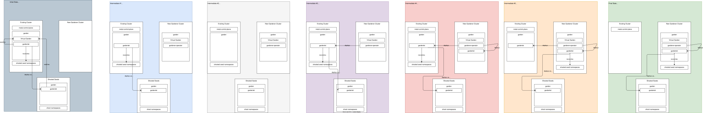

# gardener-operator

Deploys the Gardener Operator into the Garden cluster. This role spins up a virtual garden.

Please refer to the metal-stack gardener integration in our [documentation](https://docs.metal-stack.io/stable/overview/kubernetes/).

Check out the Gardener project for further documentation on [gardener.cloud](https://gardener.cloud/).

## Requirements

- Requires cert-manager with DNS cluster issuer to be deployed in the Garden cluster, if the Gardener Operator is used to deploy the Gardener dashboard. A wildcard certificate is used for the Gardener dashboard ingress domain.

## Migration Path

If you are still using the `gardener` role for setting up the Gardener, please read the following notes for the migration to the Gardener Operator.

<!-- markdownlint-disable-next-line no-blanks-blockquote -->

> [!CAUTION]
> The migration requires a downtime of the Gardener for end-users. The API servers of the end-users are not disrupted.

<!-- markdownlint-disable-next-line no-blanks-blockquote -->

> [!IMPORTANT]
> For the migration it is required to either wait until Gardener `v1.119` or use a backport feature to `force-redeploy` the existing Gardenlets. If you want to use the backports, please set the following overwrites:
>
> ```yaml
> gardener_apiserver_image_tag: gardenlet-forceful-redeployment
> gardener_apiserver_image_name: r.metal-stack.io/gardener/gardener-apiserver
> gardener_operator_image_tag: gardenlet-forceful-redeployment
> gardener_operator_image_name: r.metal-stack.io/gardener/operator
> ```

Here are the steps for the migration:

1. Prepare the Gardener Operator setup
   - Ideally, create a dedicated cluster for hosting the Gardener control plane. It is possible to also host the Gardener installation in the same cluster as the metal-stack control plane, but it is not recommended for production scenarios.
   - Prepare the new playbook that uses the roles `gardener-operator`, `gardener-cloud-profile`, `gardener-extensions`, `gardener-virtual-garden-access`, `gardener-projects`, `gardener-gardenlet`, `gardener-shoots` and `gardener-managed-seeds`. Parametrize them properly. Many parameters are equivalent as they were before, but the new roles require new ones. Check them all.
1. Scale down the existing virtual garden and take a last backup of the Garden ETCD
   - `kubectl scale deployment garden-kube-apiserver --replicas 0`
   - `kubectl exec -it <virtual-garden-etcd-sts>-0 -c backup-restore -- curl -k 'http://localhost:8080/snapshot/full?final=true'`
   - `kubectl scale sts <virtual-garden-etcd-sts> --replicas 0`
1. Copy over the ETCD backup to a new folder in the backup infrastructure
   - The object prefix changed from `etcd-<stage>-etcd` to `virtual-garden-etcd-main/etcd-main`
   - In case of using GCP copy over to the new naming scheme recursively: `gcloud storage cp -r gs://<etcd-backup-folder>/<virtual-garden-etcd-sts>/v2 gs://<etcd-backup-folder>/virtual-garden-etcd-main/etcd-main/v2`
1. ️⚠️ If you migrate from a standalone ETCD it is necessary to explicitly set `gardener_operator_high_availability_control_plane` to `false`. After the initial deployment of the virtual garden was successful, you can toggle this field to `true` in order to migrate to HA control plane. In case you deployed this without following this instruction, please repair your ETCD as described in [Recovering Etcd Clusters](https://gardener.cloud/docs/other-components/etcd-druid/recovering-etcd-clusters/).
1. Deploy the roles `gardener-operator`, `gardener-extensions`, `gardener-virtual-garden-access` and `gardener-cloud-profile` (order matters).
   - In case the `etcd-druid` does not start reconciling the `ETCD` resource for the virtual garden, you might have to manually add the finalizer `druid.gardener.cloud/etcd-druid` on the `ETCD` resource.
1. Manually deploy a kubeconfig secret for remote Gardenlet deployment through the Gardener Operator into the Virtual Garden as described [here](https://gardener.cloud/docs/gardener/deployment/deploy_gardenlet_via_operator/#remote-clusters). Delete the old Gardenlet helm chart from the original Gardener cluster and deploy the Gardenlet through the `gardener-gardenlet` role. Don't forget to specify the `gardenClientConnection.gardenClusterAddress` (see <https://github.com/gardener/gardener/pull/11996>)
   - The gardenlet name needs to be identical with the old name of the initial seed in order to take over the existing resources. Usually, we used the name of the stage for this seed.
1. If you did not take over the existing certificates from the previous Virtual Garden, it might be necessary to run `kubectl --context garden annotate managedseeds -n garden <managed-seed-resource> gardener.cloud/operation=renew-kubeconfig` in order to fix the Gardenlet deployments.
1. Reconcile your shoots, this should end up in a stable setup.
1. Deploy the `gardener-projects`, `gardener-shoots` and `gardener-managed-seeds` roles for deploying your shooted seeds.
1. To complete the migration, deploy a new Gardenlet either in a dedicated cluster or again in the Gardener cluster and execute a shoot migration of the shooted seeds to the new cluster. Follow [this document](https://github.com/gardener/gardener/blob/master/docs/operations/control_plane_migration.md#triggering-the-migration). For us, it was also necessary to edit the status of the shoot and add the missing `pods` and `services` CIDR as otherwise the proposed command from the Gardener documentation fails.
1. As the shoot migration for metal-stack is not fully working, you need to roll the firewalls of the seeds. Pay attention that the userdata of the firewall gets newly generated by the firewall-controller-manager such that it contains the new kubeconfig to contact the seed api-server.
   - In case the `keep-worker` annotation was used on a shooted seed and you want to prevent the seed worker nodes to roll, you need to set the annotation `cluster.metal-stack.io/use-worker-hash-<group-name>: <group-hash>`.



## Variables

This role depends on default values of [metal-roles/common/roles/defaults](../../../common/roles/defaults/README.md).

This role depends on default values of [metal-roles/control-plane/roles/defaults](../defaults/README.md).

```yaml
# Backup infrastructure configuration for the virtual garden etcd (provider gcp or S3). Mandatory, must not be none.
gardener_operator_backup_infrastructure: null
# Secret data for the backup infrastructure.
gardener_operator_backup_infrastructure_secret: null
# Component image vector overwrite for the gardener components.
gardener_operator_component_image_vector_overwrite: null
# Asset configuration (e.g. logos) of the gardener dashboard.
gardener_operator_dashboard_config_assets: null
# Frontend configuration of the gardener dashboard.
gardener_operator_dashboard_config_frontend: null
# Whether the gardener dashboard is deployed.
gardener_operator_dashboard_enabled: false
# Whether to create an ingress for the gardener dashboard.
gardener_operator_dashboard_ingress_enabled: true
# Log level of the gardener dashboard.
gardener_operator_dashboard_log_level: debug
# Additional OIDC scopes of the gardener dashboard.
gardener_operator_dashboard_oidc_additional_scopes:
- profile
- offline_access
# OIDC client id of the gardener dashboard.
gardener_operator_dashboard_oidc_client_id: null
# Public OIDC client id of the gardener dashboard.
gardener_operator_dashboard_oidc_client_id_public: null
# OIDC client secret of the gardener dashboard.
gardener_operator_dashboard_oidc_client_secret: null
# OIDC session lifetime of the gardener dashboard.
gardener_operator_dashboard_oidc_session_lifetime: 12h
# DNS providers configured in the garden resource.
gardener_operator_dns_providers: []
# Whether the virtual garden kube-apiserver is exposed through ingress-nginx.
gardener_operator_expose_virtual_garden_through_ingress_nginx: null
# Name of the garden resource.
gardener_operator_garden_name: '{{ gardener_defaults_garden_name }}'
# Tag of the gardener-operator helm chart. Derived from the operator image tag of the release vector by default.
gardener_operator_helm_chart_tag: '{{ gardener_operator_image_tag }}'
# Whether the virtual garden control plane is deployed highly available.
gardener_operator_high_availability_control_plane: true
# Image name of the gardener-operator. Resolved from the metal-stack release vector via setup_yaml when not set explicitly.
gardener_operator_image_name: null
# Image tag of the gardener-operator. Resolved from the metal-stack release vector via setup_yaml when not set explicitly.
gardener_operator_image_tag: null
# Image vector overwrite for the gardener components.
gardener_operator_image_vector_overwrite: null
# Git reference of the gardener repository.
gardener_operator_repo_ref: '{{ gardener_repo_ref }}'
# URL of the gardener git repository used for applying the operator CRDs.
gardener_operator_repo_url: '{{ gardener_repo_url }}'
# The provider of the runtime cluster.
gardener_operator_runtime_cluster_provider: local
# Maximum expiration of shoot admin kubeconfigs.
gardener_operator_shoot_admin_kubeconfig_max_expiration: 24h
# Structured authentication configuration for the virtual garden kube-apiserver.
gardener_operator_virtual_garden_api_server_structured_authentication: null
# Storage class of the virtual garden etcd.
gardener_operator_virtual_garden_etcd_storage_class: null
# Public DNS name of the virtual garden kube-apiserver.
gardener_operator_virtual_garden_public_dns: gardener-kube-apiserver.{{ metal_control_plane_gateway_dns }}
# Name of the cert-manager ClusterIssuer used for the wildcard ingress certificate.
gardener_operator_wildcard_ingress_certificate_cluster_issuer: null
```
